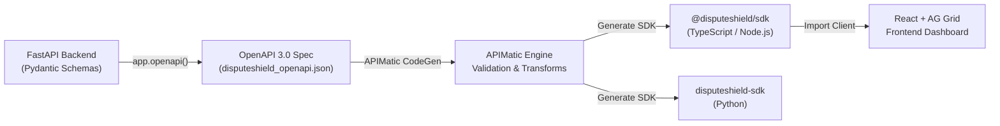

# APIMatic Integration — DisputeShield AI

DisputeShield AI uses **APIMatic** to transform our backend REST & WebSocket API surface into strongly typed, idiomatic SDKs for TypeScript, Node.js, and Python.

---

## 🚀 Overview

APIMatic bridges the gap between DisputeShield's autonomous Python FastAPI backend and our modern React/AG Grid frontend. By parsing our OpenAPI 3.0 specification ([`disputeshield_openapi.json`](./disputeshield_openapi.json)), APIMatic provides:

1. **Auto-Generated TypeScript SDK**: End-to-end type safety for PayPal dispute models, triage decisions, and predictive risk metrics.
2. **Contract Validation**: Guarantees that frontend API calls never drift from backend Pydantic schemas.
3. **Interactive Developer Portal**: Eliminates client boilerplate and powers seamless sandbox integration for merchants.

---

## 🏛️ Architecture Flow



---

## 📦 Generating the OpenAPI Specification

Run the generation script from the project root:

```bash
python scripts/generate_apimatic_sdk.py
```

This exports the standardized OpenAPI 3.0 specification to `apimatic/disputeshield_openapi.json`, enriched with APIMatic's `x-codegen-settings`:
- **Package Name**: `@disputeshield/sdk`
- **Client Class**: `DisputeShieldClient`
- **Model Package**: `models`
- **Target Languages**: TypeScript, Python

---

## 💻 TypeScript SDK Usage Example

Once generated via APIMatic, integrating DisputeShield AI into any merchant frontend or Node.js microservice requires only a few lines of code:

```typescript
import { DisputeShieldClient, DisputeStatus, DisputeReason } from '@disputeshield/sdk';

// Initialize the strongly typed client
const client = new DisputeShieldClient({
  baseUrl: 'http://localhost:8000',
  timeout: 10000,
});

async function main() {
  // 1. Fetch active disputes for AG Grid Server-Side Row Model
  const disputesPage = await client.disputesApi.getDisputes({
    startRow: 0,
    endRow: 50,
    status: DisputeStatus.WAITING_FOR_SELLER_RESPONSE,
  });

  console.log(`Fetched ${disputesPage.totalCount} active disputes from DisputeShield.`);

  // 2. Fetch real-time PayPal 1.5% limitation risk score
  const riskAssessment = await client.analyticsApi.getRiskScore();
  console.log(`Account Risk Band: ${riskAssessment.riskBand} (${riskAssessment.currentDisputeRatio}%)`);

  // 3. One-click approve and dispatch autonomous evidence package
  const approvedDispute = await client.disputesApi.approveDispute('PP-D-INR-1001', {
    approved: true,
  });

  console.log(`Dispute auto-submitted: ${approvedDispute.agentDecision}`);
}

main().catch(console.error);
```

---

## 🛡️ Coverage of API Surface

The generated APIMatic specification covers 100% of DisputeShield's API surface:

| Endpoint | Method | Description |
|:---|:---:|:---|
| `/api/disputes` | `GET` | AG Grid SSRM dispute list with pagination, sorting, and search |
| `/api/disputes/{id}` | `GET` | Master-detail dispute inspection with evidence items and reasoning |
| `/api/disputes/{id}/approve` | `POST` | Merchant 1-click approval of drafted counter-evidence |
| `/api/disputes/{id}/override` | `POST` | Merchant custom override of defense statement |
| `/api/analytics/summary` | `GET` | High-level KPI metrics (Total disputes, win-rate, capital saved) |
| `/api/analytics/win-rate` | `GET` | Detailed dispute win-rate and financial recovery breakdown |
| `/api/analytics/risk-score` | `GET` | Real-time PayPal 90-day dispute velocity & limitation forecast |
| `/api/analytics/dispute-trends` | `GET` | Time-series daily dispute volume & reason breakdown for Recharts |
| `/api/webhooks/paypal/simulate` | `POST` | Interactive demo simulation trigger for live hackathon evaluation |
