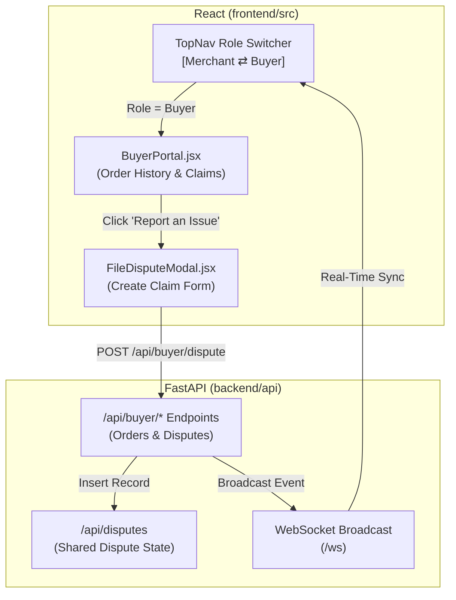

# 🛍️ DisputeShield AI — Buyer Portal & Authentication Execution Plan

> **Feature Target:** Implement Buyer Authentication & Dispute Management Portal  
> **Target Audience:** Team member / Developer assigned to the buyer flow  
> **Compatibility:** Integrates with existing FastAPI backend & React/Vite AG Grid frontend without disrupting merchant workflows.

---

## 📌 1. Objective & User Story

### Problem:
Currently, DisputeShield AI provides an enterprise merchant command center (`EliteMerchant LLC`), but dispute creation is simulated via automated scripts or the "Simulate Webhook" button. 

### Solution:
Build a **Buyer Portal** allowing customers to:
1. Log in or switch to a **Buyer Persona** (e.g., `Sarah Jenkins` - `buyer3002@example.com`).
2. View past PayPal purchase orders (`ORD-2026-9016`, etc.) and their fulfillment status.
3. Open a new dispute with custom claim reasons (`INR`, `SNAD`, `UNAUTHORIZED`) and statements.
4. Track real-time resolution status (e.g., *Waiting for Merchant*, *Evidence Submitted*, *Resolved / Refunded*).

---

## 🏗️ 2. Architectural Design



---

## 🛠️ 3. Backend Implementation Specification

### 3.1 New API Endpoints (`backend/api/buyer.py`)

Create a new router `backend/api/buyer.py` and register it in `backend/main.py`:

```python
# backend/api/buyer.py
from fastapi import APIRouter, Depends, HTTPException
from sqlalchemy.orm import Session
from database import get_db
from models.dispute import Dispute
from pydantic import BaseModel
from typing import List, Optional
from datetime import datetime

router = APIRouter(prefix="/api/buyer", tags=["buyer"])

class BuyerDisputeRequest(BaseModel):
    order_id: str
    buyer_email: str
    reason: str  # MERCHANDISE_OR_SERVICE_NOT_RECEIVED | MERCHANDISE_OR_SERVICE_NOT_AS_DESCRIBED | UNAUTHORIZED
    dispute_amount: float
    dispute_currency: str = "USD"
    buyer_message: str

@router.get("/orders")
def get_buyer_orders(email: str = "buyer3002@example.com"):
    """Returns mock orders available for the buyer to dispute."""
    return [
        {
            "order_id": "ORD-2026-9016",
            "merchant_name": "EliteMerchant LLC",
            "order_date": "2026-11-01",
            "item_name": "Ultra-Warm Goose Down Parka Jacket (Size L)",
            "amount": 65.00,
            "currency": "USD",
            "carrier": "FedEx Express",
            "tracking_number": "482910482910",
            "status": "DELIVERED",
        },
        {
            "order_id": "ORD-2026-9841",
            "merchant_name": "EliteMerchant LLC",
            "order_date": "2026-11-04",
            "item_name": "Sony WH-1000XM5 Wireless Headphones",
            "amount": 289.00,
            "currency": "USD",
            "carrier": "UPS Ground",
            "tracking_number": "1Z9999999999999999",
            "status": "DELIVERED",
        },
        {
            "order_id": "ORD-2026-9912",
            "merchant_name": "EliteMerchant LLC",
            "order_date": "2026-11-06",
            "item_name": "Digital Gaming Credit Voucher ($150)",
            "amount": 150.00,
            "currency": "USD",
            "carrier": "Electronic / Instant",
            "tracking_number": "DIGITAL-TOKEN-9912",
            "status": "COMPLETED",
        }
    ]

@router.post("/disputes")
def create_buyer_dispute(req: BuyerDisputeRequest, db: Session = Depends(get_db)):
    """Creates a new dispute from the buyer's perspective and triggers the AI agent."""
    import uuid
    from services.agent_runner import run_dispute_agent_background
    from api.ws import manager

    new_id = f"PP-D-{uuid.uuid4().hex[:6].upper()}"
    dispute = Dispute(
        paypal_dispute_id=new_id,
        paypal_order_id=req.order_id,
        buyer_email=req.buyer_email,
        dispute_amount=req.dispute_amount,
        dispute_currency=req.dispute_currency,
        reason=req.reason,
        buyer_message=req.buyer_message,
        status="UNDER_REVIEW",
        agent_decision="PENDING",
        created_at=datetime.utcnow(),
    )
    db.add(dispute)
    db.commit()
    db.refresh(dispute)

    # Broadcast WebSocket to update merchant dashboard immediately
    manager.broadcast_sync({
        "type": "new_dispute",
        "dispute_id": new_id,
        "amount": req.dispute_amount,
        "currency": req.dispute_currency,
        "reason": req.reason,
    })

    return {"message": "Dispute filed successfully", "dispute": dispute}
```

---

## 🎨 4. Frontend Implementation Specification

### 4.1 Role Switcher in `TopNav.jsx`
Add a simple Role Switcher dropdown/pill in the top navigation bar:
- `Role: Merchant (EliteMerchant LLC)` $\leftrightarrow$ `Role: Buyer (Sarah Jenkins)`

### 4.2 New Component: `BuyerPortal.jsx` (`frontend/src/components/buyer/BuyerPortal.jsx`)
Create the buyer view:
1. **Welcome Header:**
   - *"Welcome back, Sarah Jenkins (`buyer3002@example.com`)"*
   - PayPal Verified Buyer status badge.
2. **Recent Purchases List:**
   - Cards showing item name, order date, total price, and fulfillment status.
   - A prominent button: **"Report a Problem / Open Dispute"**.
3. **Active Claims Tab:**
   - Displays cases opened by this buyer with a progress stepper:
     - `1. Claim Filed` $\rightarrow$ `2. Merchant Evidence Review` $\rightarrow$ `3. PayPal Determination`

### 4.3 New Component: `FileDisputeModal.jsx` (`frontend/src/components/buyer/FileDisputeModal.jsx`)
Interactive popup modal with:
- Order reference selector.
- Dispute Reason radio options:
  - 🚚 *Item Not Received (INR)*
  - 📦 *Significantly Not As Described (SNAD)*
  - 🛡️ *Unauthorized Transaction*
- Explanation textarea: *"Explain what happened to the PayPal Resolution Center..."*
- Submit Button with loading spinner.

---

## 🚀 5. Step-by-Step Task Checklist for Teammate

| Phase | Task Description | Estimated Time | Assigned To | Status |
| :--- | :--- | :--- | :--- | :--- |
| **Phase 1** | Create git branch `feature/buyer-portal` & test local backend + frontend. | 15 mins | Teammate | ⏳ Ready |
| **Phase 2** | Add `backend/api/buyer.py` routes & test via Swagger (`/docs`). | 45 mins | Teammate | ⏳ Ready |
| **Phase 3** | Create `BuyerPortal.jsx` & `FileDisputeModal.jsx` components in `frontend/src/components/buyer/`. | 60 mins | Teammate | ⏳ Ready |
| **Phase 4** | Wire Role Switcher in `TopNav.jsx` & conditional render in `App.jsx`. | 30 mins | Teammate | ⏳ Ready |
| **Phase 5** | Test full loop: Buyer files dispute $\rightarrow$ Merchant grid auto-updates via WebSocket $\rightarrow$ AI agent triggers. | 30 mins | Both | ⏳ Ready |

---

## 🧪 6. Testing & Acceptance Criteria

1. **Clean Separation:** Toggling to `Buyer` mode shows orders and claims; toggling back to `Merchant` shows the full AG Grid command center.
2. **Real-Time Loop:** When a dispute is submitted from the Buyer Portal, a toast alert instantly appears on the Merchant side without page reloading.
3. **Build Integrity:** `npm run build` exits with code 0; `pytest backend/tests/` passes 100%.

---

## 🤝 7. Git Workflow for Teammate

```bash
# 1. Fetch latest changes
git checkout main
git pull origin main

# 2. Create feature branch
git checkout -b feature/buyer-portal

# 3. Code, commit, and push
git add .
git commit -m "feat: add buyer portal and dispute creation flow"
git push origin feature/buyer-portal

# 4. Open Pull Request on GitHub to main
```
